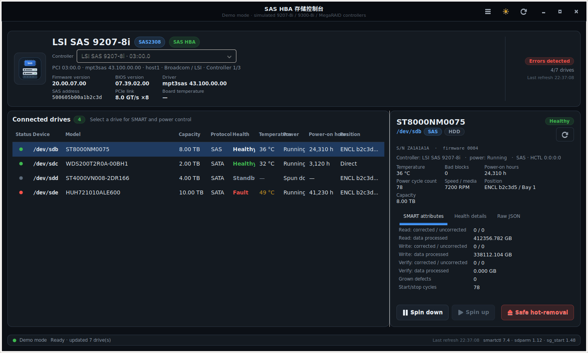

# SAS HBA 卡控制台

**SAS / SCSI / RAID 控制器与硬盘图形化控制台**，可方便的操作单盘停转、启转与安全热拔出。还有查看详细SMART信息，全面的故障检查等功能。




## 项目结构

```text
sas_hba_console/
├── __main__.py            # CLI（GUI / --diagnose / --demo / --lang）
├── i18n.py                # 语言切换运行时（t()、系统语言探测）
├── translations.py        # 中文 → English 翻译表（320 条）
├── helper.py              # root 助手：JSON 行协议 + 白名单操作
├── util.py                # sysfs 读取、命令执行、格式化
├── backend/
│   ├── pci_db.py          # pci.ids 解析 + 板卡/芯片型号识别
│   ├── sysfs.py           # 控制器发现、硬盘枚举、占用检查、总线重扫
│   ├── smart.py           # smartctl 调用与 SMART JSON 解析
│   ├── control.py         # 停转 / 启动 / 安全热拔出
│   ├── provider.py        # 真实硬件后端
│   ├── demo.py            # 三控制器演示数据
│   ├── client.py          # pkexec 助手客户端（非阻塞 JSON 行协议）
│   └── backends.py        # GUI 统一后端接口
└── ui/
    ├── app.py / window.py / dialogs.py
    ├── theme.py           # 深色/浅色 CSS、图标
    ├── format.py          # 健康判定与展示字段
    └── settings.py        # 配置持久化（含 1.x 迁移）
```

## 支持哪些卡

程序**不写死厂商或型号**，识别顺序为：

1. **`board_name`**（mpt3sas / mpt2sas 暴露的板卡名，例如 `SAS2308-8i`）→ 映射为营销型号 `LSI SAS 9207-8i`
2. **系统 `pci.ids`**（Debian/Ubuntu 的 `pciutils` 提供，位于 `/usr/share/misc/pci.ids`）
   → 任意厂商、任意新卡都能显示真实名称
3. **内置兜底表**：仅覆盖常见 Broadcom/LSI SAS 控制器（无 `pci.ids` 时使用）

已验证/内置覆盖的典型型号：

| 芯片 | 营销型号 | PCI ID | 类型 |
| --- | --- | --- | --- |
| SAS2008 | LSI SAS 9211-8i / 9211-4i | 1000:0072 | SAS HBA |
| SAS2308 | **LSI SAS 9207-8i / 8e / 4i4e** | 1000:0086 / 0087 | SAS HBA |
| SAS3008 | LSI SAS 9300-8i / 16i | 1000:0097 | SAS HBA |
| SAS3408 / 3416 | LSI SAS 9400-8i / 16i | 1000:00af / 00ac | SAS HBA |
| SAS3508 / 3516 | LSI SAS 9500-8i / 16i | 1000:00ae / 00ab | SAS HBA |
| SAS3108 | Broadcom MegaRAID 9361-8i 等 | 1000:005d | RAID |
| SAS3316 / 3324 | MegaRAID 12G | 1000:00c5…00cf | RAID |
| SmartPQI | Adaptec/Microchip SmartRAID | 9005:028f | RAID |
| PM8001/8070 | Adaptec HBA 1100 / SmartHBA | 9005:8081 / 11f8:8070 | SAS HBA |
| C600 系列 | Intel 板载 SAS（isci） | 8086:1d6x | SAS HBA |
| 任意其它 | 由 `pci.ids` 解析 | — | 按 PCI class 归类 |

> **重要修正**：`1000:0097` 实际是 **SAS3008（9300 系列）**；9207-8i 使用的是 **SAS2308（1000:0086/0087）**。
> 1.x 版本只认 `0097` 并把它标成 9207，会误判真机上的 9207。2.0 已按板卡名与 `pci.ids` 修正。

RAID 控制器（MegaRAID、SmartRAID、HPE Smart Array 等）也能被识别并显示型号/固件/驱动；
其下的逻辑卷可以查看 SMART，但**单盘停转与热拔出会自动禁用**（RAID 固件管理物理盘），
界面会说明原因并提示用 `smartctl -d megaraid,N` 或厂商工具读取物理盘。|

## 安装（Ubuntu / Debian）

### 方式一：deb 包（推荐）

```bash
sudo apt install ./sas-hba-console_2.0.0_all.deb
```

依赖会被自动安装：`python3-gi`、`gir1.2-gtk-3.0`、`smartmontools`、`sdparm`、`sg3-utils`、
`pkexec`、`pciutils`，以及 polkit 认证代理（Ubuntu GNOME 自带；Xubuntu 为 `xfce-polkit`，
Lubuntu 为 `lxpolkit`、MATE 为 `mate-polkit`）。

从 1.x 升级：新包 `Provides/Conflicts/Replaces: lsi9207-console`，会自动替换旧包，
保留 `/usr/bin/lsi9207-console` 兼容命令，并迁移 `~/.config/lsi9207-console/settings.json`。

### 方式二：源码安装

```bash
sudo apt install python3-gi gir1.2-gtk-3.0 smartmontools sdparm sg3-utils pkexec pciutils
sudo make install          # 默认 /usr
sudo make install PREFIX=/usr/local
```

### 方式三：直接运行源码

```bash
./scripts/sas-hba-console-dev            # 真实硬件 + pkexec 授权
./scripts/sas-hba-console-dev --demo     # 演示模式，不需要 root
```

## 使用

1. 从应用菜单启动「SAS HBA 存储控制台」，或运行 `sas-hba-console`。
2. 系统弹出授权窗口，输入当前用户密码（需在 sudo/admin 组）。
3. 顶部卡片显示控制器信息；多张卡时用「控制器」下拉框切换。
4. 左侧选择硬盘查看 SMART；底部为 **停转 / 启动 / 安全热拔出**。
5. 顶部 ⟳ 或 `F5` 刷新，右上 ⋯ 菜单含自动刷新、总线重扫、主题、语言、诊断信息。
6. 菜单 → **语言** 可在「简体中文 / English / 跟随系统」之间切换；切换后界面立即重建，当前控制器与硬盘选择保持不变。语言会写入配置，下次启动沿用。

命令行：

```text
sas-hba-console [--demo] [--no-elevate] [--mode {auto,demo,local,readonly,privileged}]
                [--lang {auto,zh_CN,en_US}] [--sys-root DIR] [--diagnose] [--version]
```

* `--demo`：内置 9207-8i、9300-8i、MegaRAID 3108 三个模拟控制器与 7 块盘。
* `--diagnose`：输出 JSON 诊断（所有控制器、pci.ids 路径、工具版本、权限），不开界面。
* `--lang`：界面语言，默认 `auto`（中文环境用中文，其它用英文）；也可强制 `zh_CN` / `en_US`。
* `--sys-root`：指定根目录读取 sysfs/proc，便于测试或救援环境。


## 安全说明

* **挂载检查**：硬盘上有挂载（含 `/`、`/boot`）、交换、LVM/RAID/dm-crypt 时，停转与热拔出按钮禁用并列出原因。
* **能力位**：RAID 控制器与虚拟 SCSI 上的设备自动禁用单盘电源/热拔操作，后端也会二次拒绝。
* **设备校验**：只接受 `^/dev/sd[a-z]+$` 且仍在已识别控制器的 sysfs 树中的设备；不执行任意命令、不走 shell。
* **权限最小化**：GUI 不以 root 运行；polkit 策略只允许执行助手程序，助手仅实现
  `snapshot` / `smart` / `spin_down` / `spin_up` / `hot_remove` / `rescan` 六个操作。
* **热拔出的边界**：直通卡不控制硬盘仓位供电，本操作是“内核安全移除设备”；能否物理拔出取决于
  机箱托架/背板是否支持热插拔。

## 调试与验证

```bash
sas-hba-console --diagnose | jq '{pci_ids_path, hbas: [.hbas[] | {model, chip, kind, driver}]}'
lspci -nnk | grep -A3 -iE 'sas|raid|scsi'
lsmod | grep -E 'mpt3sas|mpt2sas|megaraid|smartpqi|hpsa|isci'
for h in /sys/class/scsi_host/host*; do echo -n "$h: "; cat $h/proc_name; done
python3 -m unittest discover -s tests -v      # 77 个测试，不需要真实 HBA
python3 scripts/check_i18n.py                 # 校验中英文覆盖率与占位符一致性
```

